<div align="center">

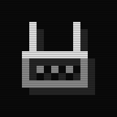

**luci-theme-pixel**<br>
Монохромная тема веб-интерфейса OpenWrt (LuCI), нарисованная по пиксельной сетке.

[](https://github.com/Trendorin/luci-theme-pixel/releases/latest)
[](https://github.com/Trendorin/luci-theme-pixel/releases)
[](LICENSE)
[](#совместимость)

[Скачать](https://github.com/Trendorin/luci-theme-pixel/releases/latest) · [Установка](#установка) · [Скриншоты](#скриншоты) · [English](README.md)


</div>

## Установка

Пакет не зависит от архитектуры роутера. Команды выполняются на роутере (по SSH):

**OpenWrt 25.12 и новее** (apk)

```sh
cd /tmp
wget https://github.com/Trendorin/luci-theme-pixel/releases/latest/download/luci-theme-pixel.apk
apk add --allow-untrusted luci-theme-pixel.apk
```

**OpenWrt 23.05 и 24.10** (opkg)

```sh
cd /tmp
wget https://github.com/Trendorin/luci-theme-pixel/releases/latest/download/luci-theme-pixel_all.ipk
opkg install luci-theme-pixel_all.ipk
```

Обновите страницу веб-интерфейса. Первая установка делает Pixel активной темой; при обновлении остаётся та тема,
которую вы выбрали. Файлы с номером версии и контрольные суммы (`SHA256SUMS`) — на [странице релизов](https://github.com/Trendorin/luci-theme-pixel/releases).

<details>
<summary><b>Переключить, обновить или удалить</b></summary>

- **Переключить тему:** System → System → Language and Style → Design. Из консоли:
  `uci set luci.main.mediaurlbase=/luci-static/bootstrap && uci commit luci`.
- **Обновить:** выполнить те же команды ещё раз. Выбранная тема не меняется.
- **Удалить:** `apk del luci-theme-pixel` или `opkg remove luci-theme-pixel`. Если Pixel была активной, LuCI вернётся к Bootstrap.
- **Видны куски старой темы?** Обновите страницу один раз с <kbd>Ctrl</kbd>+<kbd>Shift</kbd>+<kbd>R</kbd>.
- **Иконка на телефоне:** откройте LuCI в Chrome или Samsung Internet → меню → **Добавить на главный экран**.

</details>

## Скриншоты

Все страницы — стандартные страницы LuCI, отличается только тема. Адреса, имена и журналы на картинках вымышленные.

### Тёмная и светлая

Кнопка в верхней панели переключает **авто → тёмная → светлая**. «Экраны» (картинка входа, журналы, графики)
остаются тёмными в обеих темах.

| Обзор состояния, тёмная | Та же страница, светлая |
|---|---|
| 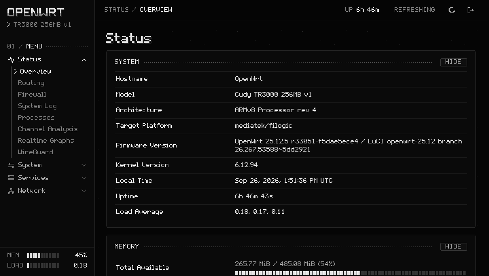 | 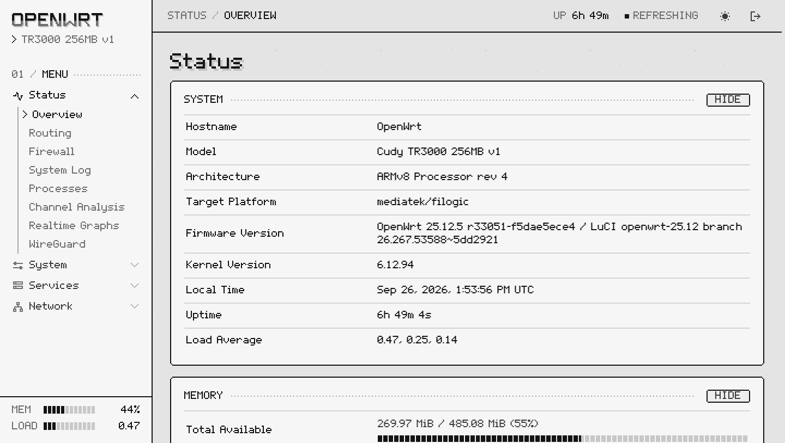 |

### Повседневные страницы

| Network → Interfaces | Network → Wireless |
|---|---|
| 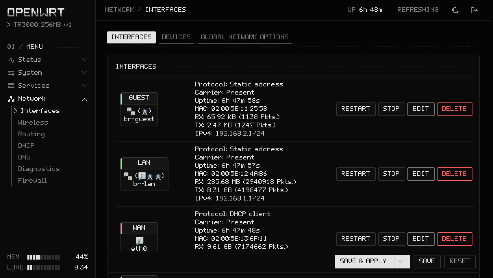 | 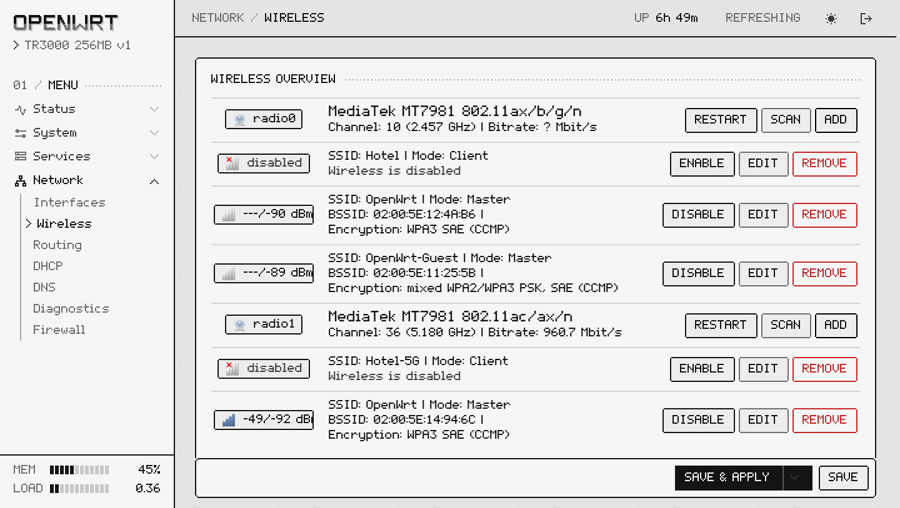 |

### Окна и журналы

| Окно настройки: однобитное окно с полосатым заголовком | System Log — прокручиваемый «экран» |
|---|---|
| 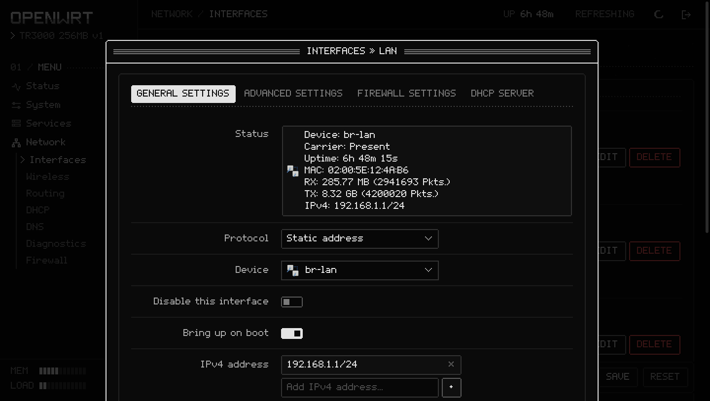 | 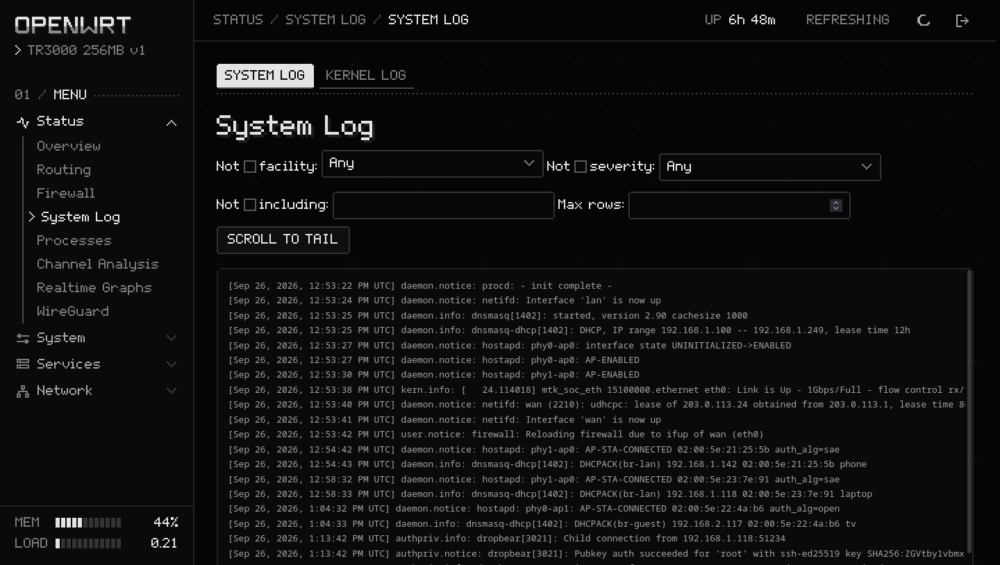 |

### Графики и настройки

| Графики в реальном времени на тёмном экране | Language and Style: выбор темы |
|---|---|
| 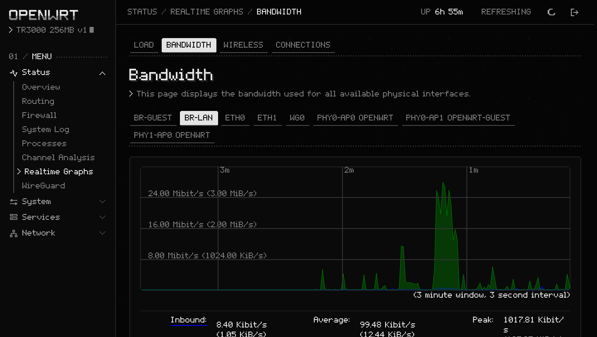 | 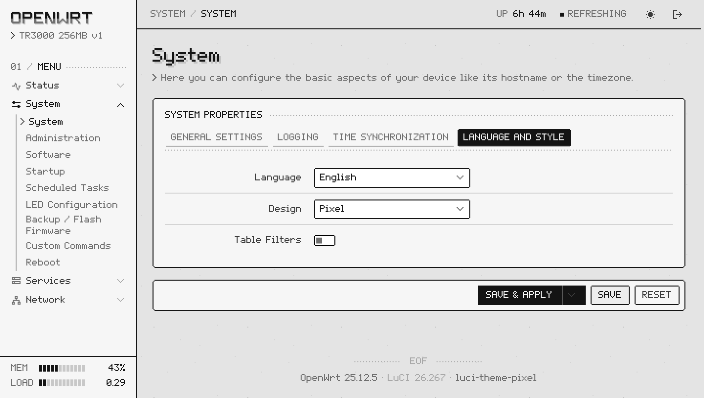 |

### На телефоне

| Вход | Состояние | Меню |
|---|---|---|
| 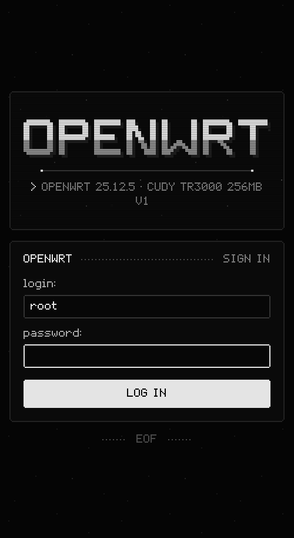 | 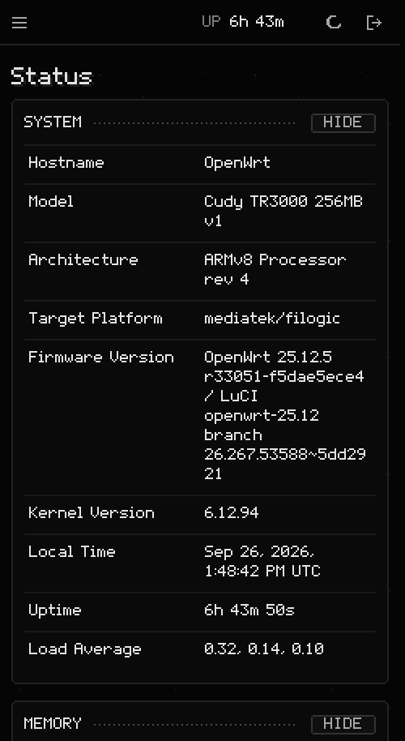 | 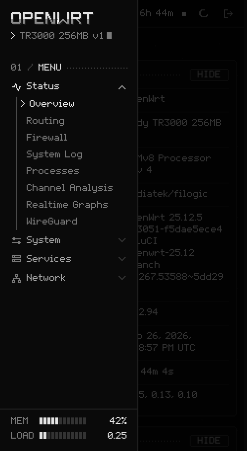 |

### Ваш роутер — ваше имя

Тема не привязана к одному устройству: имя и модель она берёт у самого роутера. Длинное имя переносится на вторую
строку после `-`, `_` или `.`, а из модели в боковой панели убираются уточнения в скобках.

| Короткое имя | Длинное имя и модель (смоделировано) |
|---|---|
|  | 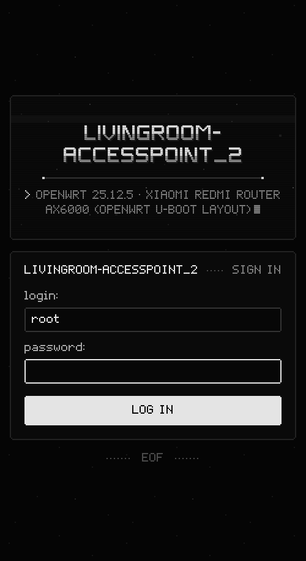 |

## Возможности

- **Пиксельный шрифт 5×7** с латиницей, кириллицей и знаками интерфейса (%, °, стрелки, «», ✓…), собранный из
  битмап-глифов. Размеры кратны 10 px, поэтому каждый пиксель шрифта ложится на целые пиксели экрана и текст остаётся
  чётким; каждый глиф — один контур, без тонких швов на телефонах с дробным масштабом.
- **«Экранная» палитра:** почти чёрный и светло-серые тона, рамки со срезанными углами, пунктирные линейки и строки
  развёртки ЭЛТ. Красный — только для ошибок и опасных кнопок.
- **Анимации, все ступенчатые:** имя роутера проявляется из шума буква за буквой и по нему пробегает блик,
  подзаголовки печатаются за мигающим курсором, страницы появляются с мерцанием старого монитора, индикатор загрузки —
  бегущий пиксельный блок. `prefers-reduced-motion` отключает всё.
- **Перерисованы все стандартные элементы LuCI:** формы, вкладки, таблицы, выпадающие списки, динамические списки,
  пиксельные чекбоксы и переключатели, сегментные прогресс-бары, модальные окна, блоки состояния, значки зон,
  журналы и графики.
- **Любой роутер:** имя и модель читаются с самого роутера (`system board`), ничего не зашито. Длинные имена переносятся
  на две строки, а не сжимаются и не обрезаются; у всех символов, допустимых в имени OpenWrt (A–Z, 0–9, `-`, `_`, `.`),
  есть глифы в крупном шрифте.
- **Боковая и верхняя панели:** живые память и нагрузка в боковой панели, время работы в верхней (стандартный вызов `system info`).
- **Вёрстка для телефона** с выезжающим меню, иконки для главного экрана и манифест веб-приложения.
- **Автономность:** шрифты и графику отдаёт сам роутер. Никаких внешних запросов, бэкенда и дополнительных прав доступа.

## Совместимость

| OpenWrt | Пакет | Состояние |
|---|---|---|
| 25.12 | `.apk` | Проверено на 25.12.5 (LuCI 26.267), Cudy TR3000: установка, обновление, удаление, повторная установка. 1.0.1 учитывает изменения разметки 25.12.6 (LuCI 26.288) |
| 24.10 | `.ipk` | Собрано SDK 24.10; тот же API тем на ucode, на роутере с 24.10 ещё не ставилось |
| 23.05 | `.ipk` | Тот же API тем на ucode; на роутере с 23.05 ещё не ставилось |

Нужен LuCI с шаблонами на ucode. Подходит любой современный браузер (тема использует CSS `clip-path`, `color-mix`
и пользовательские свойства). Отчёты с других роутеров и версий — в [issues](https://github.com/Trendorin/luci-theme-pixel/issues).

## Сборка из исходников

С OpenWrt SDK или buildroot:

```sh
cp -r luci-theme-pixel <sdk>/package/
cd <sdk> && make defconfig && make package/luci-theme-pixel/compile
```

Без SDK: `tools/build_pkg.py [ПАПКА]` собирает те же `.apk` и `.ipk` (раскладка, метаданные и скрипты установки
из Makefile; для `.apk` нужен apk-tools 3, например `dnf install apk-tools`).

| Инструмент | Что делает |
|---|---|
| `tools/profile_glyphs.py` | глифы 5×7 и 12-строчный шрифт для крупных надписей |
| `tools/extra_glyphs.py` | кириллица и знаки интерфейса |
| `tools/build_font.py` | собирает `fonts/pixel-5x7.woff2` (нужны `fonttools` и `brotli`) |
| `tools/build_art.py` | фавикон, иконки для главного экрана и манифест (только стандартная библиотека) |
| `tools/build_pkg.py` | `.apk` и `.ipk` без SDK |
| `tools/preview/` | локальный стенд: файлы темы из репозитория, стандартные страницы LuCI и запросы только на чтение к настоящему роутеру по SSH. `SANITIZE=1` заменяет MAC, IP, SSID, имена и секреты, `DEMO=1` показывает вымышленные журналы; `shot.py` делает скриншоты, `anim.py` записывает GIF экрана входа |

## Изменения

- **1.0.1** — готово к OpenWrt 25.12.6 (LuCI 26.288), где журналы, «Процессы», «Автозагрузка», таблицы файрвола и
  менеджер пакетов обёрнуты в секции: системный журнал и журнал ядра остаются тёмным экраном, а не теряются в карточке
  того же цвета; названия таблиц nftables — обычные заголовки, а не пустые карточки; панель «Сохранить» в «Автозагрузке»
  отделена от секции. Имя и модель роутера экранируются везде, так что кавычки в имени больше не ломают разметку страницы.
- **1.0.0** — первый релиз.

Подробности и файлы каждой версии — на [странице релизов](https://github.com/Trendorin/luci-theme-pixel/releases).

## Авторы и лицензия

Глифы 5×7 и крупного шрифта нарисовал [Trendon (@Trendorin)](https://github.com/Trendorin).
Лицензия — [Apache License 2.0](LICENSE).
